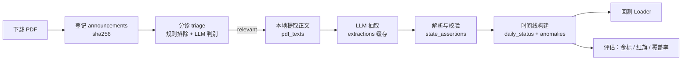

# 重构方案：申购状态时间线（v2）

> 日期：2026-11-18 · 状态：草案，待确认
> 范围：替换"公告解析 → `subscription_restrictions` → `postprocess.py` → `limit_events` → `DataLoader`"这条链路，并修正回测侧会直接影响结论的几处问题。

---

## 1. 为什么要重构

### 1.1 现状：回测结论不可信，误差系统性偏向虚高

| 现象 | 证据 |
|---|---|
| 8 次真实数据回测收益率从 -81% 到 +67089% | `output/2026040*`、`output/20260413_*` |
| 最近一次回测 +9870%，利润约 104.6 万，其中 **160723 一只占约 100.9 万（≈96%）** | `output/20260413_154550/trade_logs.csv` |
| 160723 被买入 147 次，溢价 9%~17%，单日最多 10 万，`daily_limit = inf` | 同上 |
| 实际上 160723 **自 2020-03-16 起暂停申购**，直到 2024-02-28 才恢复，恢复后限额 1 万 | `160723/2023-11-21_…暂停赎回业务的公告.pdf` 原文 |
| 从 2022 年起，"被标为不限购、溢价却连续 ≥3 日 >5%"的基金日共 492 个，涉及 64 只基金（算上 2021 年是 738 个、96 只） | `scripts/red_flags.py` 在旧数据上的结果（见 §7.4） |
| 对照 19 只基金的金标，旧数据有 2282 个交易日过于宽松，最近一次回测在这些基金上的利润 99.9% 来自这些日子 | [docs/eval/README.md](eval/README.md)（阶段 A 基线） |

高溢价之所以长期存在，往往**正是因为申购被关了**。所以限购数据只要有缺口，回测就会专挑这些日子"套利"。这类误差不是随机噪声，修几个 bug 消除不了。

### 1.2 根因

1. **数据模型错了：拿"动作事件"去还原"状态"。**
   公告本质上是在声明某个状态：有的改变长期基线，有的是带起止日的临时覆盖，有的只是顺带陈述既有状态。旧设计把公告抽成 `restrict/suspend/resume` 动作，再用配对的方式还原区间，因此只能靠一堆补丁维持：
   - 每个 `restrict` 向后找最近一条"非节假日 resume"来闭合区间；
   - Loader 对重叠区间取最小值（`clip(upper=)`），限额只能越调越低。160416 在 2025-09-24 已调到 1 万，回测看到的仍是 10 元。31 只基金共 5152 个基金日受影响；
   - 靠文件名子串（"节假日""境外""年+安排"）区分临时和长期；
   - 用"合成自 2000-01-01 起的暂停"补数据窗口之前的状态（90 条）；
   - 去重键 `(fund, effective_date, action)` 会误合并不同渠道的记录。
2. **维度被压扁。** 每天只剩一个 `max_amount`。抽出来的渠道、业务、份额类别都在 `limit_events` 这一步丢了：
   - 309 条"部分渠道"的暂停或限额被当作整只基金的限制；
   - 162411 在 2025-03-06 是"代销 100 元 / 直销 5000 元"，被压成一个数。
3. **"查不到"被当成"不限购"。** 这是 160723 事件的直接原因。
4. **召回漏掉了关键证据。** 标题过滤要求含"申购"，11802 份 PDF 只解析了 2865 份。被跳过的"暂停赎回业务"公告恰恰在说"本基金自 2020 年 3 月 16 日起暂停申购"。抽样 160 份限制相关公告，约 12% 含这类背景陈述。
5. **没有度量。** 准确率只来自 6 个抽查样例，没有标准答案集，也没有从市场行为出发的反向校验。
6. **不可复现。** 写库只追加不清空（表里 11875 行，实际约 6000 条），LLM 原始输出没有按版本缓存，temperature=1。

---

## 2. 目标、非目标与完成标准

**目标**：对每只 LOF 的每个交易日，给出**"场内份额 × 场内/代销渠道 × 申购业务"这条路径上，单账户单日最多能申购多少钱**，允许值为"未知"，每个值都能追溯到 PDF 原文。在此基础上得出一个能被审计的回测结论。

**非目标**（本期不做，但 schema 预留）：
- 折价套利（赎回侧）。schema 里业务维度含 `redemption`，以后可以直接复用；
- 预测未来公告、实时监控。

**完成标准**：
1. 在金标集（§7.3）上，**套利相关日（溢价 > 买入阈值）的"过松"天数为 0**，**整体逐日一致率 ≥ 98%**（限额状态要求金额也一致）。旧数据的基线是：相关日过松 376 天、整体一致率 80.3%（见 [docs/eval/README.md](eval/README.md)）。
2. 每个非"开放"的交易日都能追溯到至少一条原文引用通过校验的状态声明。
3. 红旗报告（§7.4）里的每一条，要么已修复，要么人工确认为"市场原因、非数据缺失"。
4. 回测同时给出保守和乐观两个边界（§8.2），并按状态来源做利润归因。来自 `unknown` 或推断状态的利润单独列示。
5. 同一份抽取缓存可以确定性地重建出同一份 `daily_status`，进而得到同一份回测结果。

---

## 3. 设计原则

1. **公告 = 状态声明**，不再做 suspend/resume 配对。
2. **未知 ≠ 不限**。`unknown` 是一等状态，回测必须显式选择怎么对待它。
3. **只物化套利真正走的那条路径**。抽取时保留全部维度，物化时再筛选。
4. **每个数值都能溯源**：抽取结果必须带原文引用，并自动校验它是正文的子串。
5. **确定性重建**：LLM 原始输出按 `(pdf_sha256, prompt_version, model)` 缓存。从缓存到 `daily_status` 是纯函数。
6. **不靠文件名猜语义**：临时还是长期、背景陈述还是变更，全部由抽取 schema 显式表达。
7. **用市场行为反验数据**：持续高溢价却被标为开放，就是红旗。
8. **先度量，再改进**：金标集和评估脚本先于新抽取上线。

---

## 4. 领域模型

### 4.1 术语

| 术语 | 含义 |
|---|---|
| **公告** Announcement | 一份 PDF，以 sha256 唯一标识 |
| **路径** Path | `(份额代码, 渠道, 业务)` |
| **目标路径** Target path | `(场内代码, exchange / agency / all, purchase)`，是套利实际经过的路径 |
| **状态** Status | `open`（不限）/ `limited`（单日单账户上限 `amount` 元）/ `closed` / `unknown`（`unknown` 只在物化结果中出现） |
| **层** Layer | `baseline`：长期状态，没有结束日，直到被下一条 baseline 取代<br>`overlay`：临时状态，**有明确结束日**，结束后回落到当时的 baseline |
| **类型** Kind | `change`：本公告做出的变更，如"自 X 日起暂停大额申购"<br>`restatement`：公告顺带陈述的既有状态，如"根据相关公告，本基金自 2020 年 3 月 25 日起暂停申购" |
| **前置状态** prior_status | 一条 change 暗示的变更前状态。比如"恢复申购"暗示之前是 `closed`，"恢复大额申购"暗示之前是 `limited` |
| **状态声明** StateAssertion | 一条结构化断言：路径集合 + 状态 + 金额 + 起止日 + 层 + 类型 + 原文引用 |

### 4.2 各类公告在新模型下的表达

| 公告类型 | 状态声明 |
|---|---|
| 暂停大额申购 / 调整限额 | baseline · change · `limited(amount)` |
| 暂停申购 | baseline · change · `closed` |
| 恢复申购 | baseline · change · `open`，`prior_status=closed` |
| 恢复申购并暂停大额申购（如 162411 2025-03-05） | baseline · change · `limited(100)`，渠道 agency；另有一条 direct 渠道的 5000（物化时会被过滤掉），`prior_status=closed` |
| 境外节假日暂停申购赎回（单日） | overlay · `closed` · `[d, d]` |
| 节假日公告中写"X 日起恢复赎回，继续暂停申购"（如 162411 2025-01-08） | overlay `closed [1/9, 1/9]`，**外加** baseline · change · `closed`，自 1/10 起 |
| 只暂停赎回、正文写"本基金自 2020-03-16 起暂停申购"（如 160723 2023-11-21） | 赎回 overlay，**外加** baseline · restatement · `closed`，自 2020-03-16 起，观察日 2023-11-21 |
| A 类恢复申购，C 类和美元份额仍暂停（如 161116 2025-04-23） | 按份额代码拆成多条，物化时只取场内代码那条 |
| 定期开放基金的开放期 | overlay · `open` · `[开放起, 开放止]`，外加 baseline · change · `closed`，自开放止次日起 |
| 申请不予确认（突发休市） | overlay · `closed` · `[d, d]` |
| 规模上限 / 比例确认 | baseline · `limited`，`amount=null`，进入异常表人工处理 |
| 某一家销售机构暂停 | 渠道 `specific`，不会进入目标路径 |

---

## 5. 存储设计

新建 `data/real_all_lof/config/subscription_state.db`。旧的 `fund_status.db` 只读保留，迁移期间作为对照基线，阶段 G 删除。

```sql
-- 1) 公告清单：下载时登记全部 PDF，不做标题过滤
CREATE TABLE announcements (
  id            INTEGER PRIMARY KEY,
  fund_code     TEXT NOT NULL,              -- 目录名（主代码）
  announce_date DATE NOT NULL,              -- 文件名中的日期
  title         TEXT NOT NULL,
  rel_path      TEXT NOT NULL UNIQUE,
  sha256        TEXT NOT NULL,              -- 内容变了（sha 变化）时清空 triage，重新分诊
  size_bytes    INTEGER NOT NULL,
  triage        TEXT CHECK (triage IN ('relevant','irrelevant','unsure')),
  triage_by     TEXT                        -- 'rule:<name>' / 'llm:<model>@<prompt_version>'
);

-- 2) 正文缓存：本地提取，供 LLM 输入和原文引用校验；按 sha256 去重
CREATE TABLE pdf_texts (
  sha256     TEXT PRIMARY KEY,
  extractor  TEXT NOT NULL,                 -- 'pdfplumber@<ver>' / 'ocr' ...
  text       TEXT NOT NULL,                 -- pdfplumber 原样输出，页与页之间用 \f 分隔
  tables     TEXT NOT NULL DEFAULT '[]',    -- JSON：extract_tables() 的结果 [{page, rows}]
  n_pages    INTEGER,                       -- 打不开时为 NULL
  is_empty   INTEGER NOT NULL DEFAULT 0,    -- 扫描件等提不出文字的情况
  error      TEXT                           -- 打不开的原因，或"超过 60 页被截断"
);

-- 3) 抽取运行：保存 LLM 原始输出，作为可复现的缓存键
CREATE TABLE extractions (
  id              INTEGER PRIMARY KEY,
  sha256          TEXT NOT NULL,
  prompt_version  TEXT NOT NULL,
  model           TEXT NOT NULL,
  raw_response    TEXT,
  status          TEXT NOT NULL CHECK (status IN ('ok','schema_error','api_error')),
  error           TEXT,
  created_at      TIMESTAMP DEFAULT CURRENT_TIMESTAMP,
  UNIQUE (sha256, prompt_version, model)
);

-- 4) 状态声明
CREATE TABLE state_assertions (
  id             INTEGER PRIMARY KEY,
  extraction_id  INTEGER NOT NULL REFERENCES extractions(id),
  sha256         TEXT NOT NULL,             -- 冗余，方便按文件查
  fund_code      TEXT NOT NULL,
  share_codes    TEXT NOT NULL,             -- JSON 数组；["*"] 表示所有份额
  channel        TEXT NOT NULL CHECK (channel IN ('all','exchange','agency','direct','specific')),
  businesses     TEXT NOT NULL,             -- JSON：purchase/fixed_invest/convert_in/redemption/convert_out
  status         TEXT NOT NULL CHECK (status IN ('open','limited','closed')),
  amount         REAL,                      -- 单日单账户上限，统一换算成元
  currency       TEXT NOT NULL DEFAULT 'CNY',
  valid_from     DATE NOT NULL,
  valid_to       DATE,                      -- 非空即 overlay
  layer          TEXT NOT NULL CHECK (layer IN ('baseline','overlay')),
  kind           TEXT NOT NULL CHECK (kind IN ('change','restatement')),
  observed_on    DATE NOT NULL,             -- 公告日；restatement 的有效范围是 [valid_from, observed_on]
  prior_status   TEXT CHECK (prior_status IN ('open','limited','closed')),
  evidence       TEXT NOT NULL,             -- 原文引用
  evidence_ok    INTEGER NOT NULL,          -- 规范化后是否为正文子串
  CHECK (layer = 'overlay' OR valid_to IS NULL),
  CHECK (layer = 'baseline' OR valid_to IS NOT NULL)
);

-- 5) 物化的每日状态：只存目标路径
CREATE TABLE daily_status (
  fund_code      TEXT NOT NULL,
  date           DATE NOT NULL,             -- A 股交易日
  status         TEXT NOT NULL CHECK (status IN ('open','limited','closed','unknown')),
  amount         REAL,                      -- 仅 limited 时有值；limited 且金额不明时为 NULL
  source         TEXT NOT NULL CHECK (source IN ('overlay','change','restatement','inferred_prior',
                                                'inferred_open','default')),   -- inferred_open 见 §7.2 阶段 D 实现
  assertion_ids  TEXT NOT NULL DEFAULT '[]',
  PRIMARY KEY (fund_code, date)
);

-- （金标不放数据库：放在 data/gold/timeline.csv，随代码入库、可以 diff，见 §7.3）

-- 6) 异常：冲突、红旗、校验失败
CREATE TABLE anomalies (
  id INTEGER PRIMARY KEY, fund_code TEXT NOT NULL, date_from DATE, date_to DATE,
  kind TEXT NOT NULL,      -- conflict / restatement_mismatch / evidence_fail / red_flag / null_amount ...
  sha256 TEXT,             -- 抽取阶段的异常记来源文件
  detail TEXT, assertion_ids TEXT, resolved INTEGER NOT NULL DEFAULT 0, resolution TEXT
);
```

`state_assertions` 和 `daily_status` 每次都从缓存**整表重建**，不做追加，也不做原地更新。

---

## 6. 流水线



### 6.1 分诊

- **规则排除**：命中销售机构、费率优惠、定期报告、招募说明书、基金合同、分红、经理变更、清算等标题的，标为 `irrelevant`。按我抽样时用的规则粗算，11802 份里剩约 3200 份候选。
- **不再要求标题含"申购"**。"暂停赎回""暂停申赎""交易日安排""开放安排""延长开放期"都必须进入候选。
- 剩下标为 `unsure` 的，交给 LLM 根据"标题 + 正文前 800 字"做二分类。
- **召回验收**：金标集引用到的每一份 PDF 都必须被分为 `relevant`。

**阶段 B 实际结果**（2026-11-18，详见 [docs/eval/corpus-report.md](eval/corpus-report.md)）：

- 规则按顺序匹配，命中第一条即停：文档类型（定期报告等）→ 单家销售机构的暂停或终止 → 申购状态关键词 → 销售与费率 → 其余为 unsure。实现在 `src/pipeline/triage.py`。
- 11,802 个文件（5,277 份不同内容）中，relevant 3,292 个文件 / 2,798 份内容；规则只留下 19 个文件（5 份内容）给 LLM，判出 2 份相关、3 份不相关。
- 金标中 high / medium 置信度引用的 391 份 PDF 全部为 relevant。low 置信度的两只（169201、162207）引用的是费率优惠公告，只用来证明基金在售，不计入召回。
- 交叉检查：旧链路抽出过限购记录的 2,801 份 PDF 中，2,800 份为 relevant；唯一例外是"停止网上直销"，属于直销渠道，不在目标路径上。

### 6.2 正文提取

- 以本地 pdfplumber 为主（在现有 [pdf_extractor.py](../src/data/pdf_extractor.py) 基础上扩展），不再依赖 Kimi 的文件接口。原因有三：任意 OpenAI 兼容模型都能用；正文要拿来校验原文引用；缓存可复现。
- 公告首页基本都是"公告基本信息"表格，pdfplumber 会把单元格文字打散（比如"恢 复相 关"）。可以同时输出 `extract_tables()` 的结果作为第二份上下文。
- 对提取为空的扫描件，标记 `is_empty`，进入人工或 OCR 队列，不要静默跳过。
- **小字号页面**（2026-11-18 全量抽取时发现）：有的管理人把整份公告连同表格排在一页 A4 上，正文字号只有 2～4pt。pdfplumber 默认 3pt 的字符合并容差比一个字还宽，相邻列会被拼成"份金 基起日市"这样的乱码，506008 的开放期公告就因此连续超时。现在容差取该页中位字号的 0.4 倍（上限 3pt，下限 0.5pt），9pt 以上的正常页面输出不变。215 份小字号公告里，有 166 份的正文因此变得可读。提取器版本记为 `pdfplumber@<ver>+fonttol`，刷新命令是 `build_corpus.py texts --refresh`。
- 抽取缓存记下模型输入的指纹（`input_sha`）。正文缓存刷新后，只重抽输入真正变了的公告，这次是 167 份。

### 6.3 LLM 抽取

**模型与网关**（按你的要求，所有真实模型调用都走本地网关）：

| 配置项（`.env`） | 值 |
|---|---|
| `LOF_LLM_BASE_URL` | `http://127.0.0.1:3425/v1` |
| `LOF_LLM_API_KEY` | 只写在 `.env`，不入库（`.env` 已在 `.gitignore` 中） |
| `LOF_LLM_MODEL` | `workbuddy/glm-5.3-flash` |
| `LOF_LLM_REASONING` | `low` / `medium` / `high`，作为 `reasoning_effort` 发送；分诊用 `low`，抽取打算用 `high` |
| `LOF_LLM_TIMEOUT`、`LOF_LLM_MAX_RETRIES` | 可选，默认 120 秒、重试 4 次 |

- 变量名带 `LOF_` 前缀：`.env` 里已有旧 Kimi 链路的 `LLM_API_KEY` / `LLM_MODEL`，用同名会覆盖它们；也不用 `OPENAI_*`，以免误用 shell 里的真实 OpenAI 密钥。
- 客户端在 `src/pipeline/llm.py`：网络错误、超时、429 和 5xx 做指数退避重试（有 `Retry-After` 时按它等），400 类错误不重试；tool call 的参数解析失败时回退到在正文里找 JSON。
- 已于 2026-11-18 确认网关可用。该模型上下文 1M，支持强制 `tool_choice`，返回 `reasoning_content`；`reasoning_effort=low` 时一次简单分诊约 3 秒、50 个输出 token，不设时约 11 秒、300 个。请求须从 Python 以 UTF-8 发出：Git Bash 下用 curl 发中文 prompt 时出现了乱码。
- 用 tool calling 并给出严格的 JSON schema 来约束输出，解析失败时回退到在正文里查找 JSON。
- 并发可配置，默认 8；对 429、5xx、超时做指数退避重试。重试用尽后才标记为 `api_error`。
- **成本**：按网关标价（输入约 $0.12/M token、输出约 $0.42/M token）粗估，约 3200 份 PDF 全量跑一次大约在几美元量级。所以可以负担对同一份 PDF 跑两次并比对结果（§7.1）。

**输出 schema**（`prompts/extract_v2.md`，版本号写进 `prompt_version`）：

```json
{
  "relevant": true,
  "share_classes": [
    {"code": "162411", "name": "华宝油气LOF", "listed_on_exchange": true},
    {"code": "007844", "name": "华宝油气C", "listed_on_exchange": false}
  ],
  "assertions": [
    {
      "share_codes": ["162411", "007844"],
      "channel": "agency",
      "businesses": ["purchase", "fixed_invest"],
      "status": "limited",
      "amount": 100,
      "currency": "CNY",
      "valid_from": "2025-03-06",
      "valid_to": null,
      "layer": "baseline",
      "kind": "change",
      "prior_status": "closed",
      "evidence": "在各代销机构的单日单个基金账户累计申购（含定投）金额上限设置为 100 元"
    }
  ]
}
```

**Prompt 的关键规则**：
1. 公告里**每一句**涉及申购、赎回状态的话都要输出，包括"根据相关公告，本基金自 X 起暂停申购"这类背景陈述（`kind=restatement`）。
2. 节假日公告里如果出现"继续暂停""仍暂停""恢复后仍受相关限制"，要另外输出 baseline 声明。
3. 只要有明确的结束日，就是 `overlay`；没有结束日，就是 `baseline`。
4. 每条声明都要列出适用的**份额代码**。人民币份额和美元份额分开，美元金额不换算，`currency=USD`。
5. 渠道：写"各代销机构""销售机构"的取 `agency`；写"直销柜台""网上直销"的取 `direct`；写"场内"的取 `exchange`；写全部、未区分的取 `all`；点名某一家机构的取 `specific`。
6. `evidence` 必须是从正文**原样摘出**的连续片段，不能改写。
7. "万元"换算成元；"不超过 X 元（含）"中的 X 就是 `amount`。
8. 只要是"恢复"类变更，就填 `prior_status`。
9. Few-shot 示例取自真实公告。实际用的 6 个全部是 2025 年的公告，和 2021~2024 的评估窗口不重叠，避免示例泄露答案：162411 的 2025-01-08（节假日暂停 + 继续暂停申购）和 2025-03-05（按渠道、份额设限额）、161129 的 2025-01-08（暂停赎回公告里的背景陈述，代替原计划的 160723 2023-11-21）、161116 的 2025-04-23（只有 A 类恢复）、501088 的 2025-10-09（定期开放）、161815 的 2025-02-13（家族公告）。

**实现时补充的规则**（`prompts/extract_v2.md`，当前版本 `extract-v2.2`）：

- 只输出申购类业务（申购、定投、转换转入）的声明；只涉及赎回的句子不输出，因为它们不在目标路径上。
- 抽取按 sha256 缓存，所以一份家族公告只调用一次；输入里的"要抽取的基金代码"是所有存有这份文件的基金目录。这组代码记在缓存里，代码变了就重新抽取。
- "由 X 元调整为 Y 元"时，除了 `limited Y` 的 change，另输出一条 `limited X` 的 restatement（v2.1 新增，否则 501300 2022-04 之前的 50 万限额无处可查）。
- 没写起始日的 restatement（"C 类仍暂停申购"），`valid_from` 填公告日。
- 输入同时给正文和渲染后的表格（单元格用 ` | ` 分隔）。
- 节假日公告里"X 日起恢复日常申购"只是 overlay 的结束，不再输出 baseline `open`；"恢复后仍限 X 元"标为 restatement（v2.2 新增，并加了第 7 个示例 160723 2025-01-07）。v2.1 在这里系统性出错：36 条 baseline `open` 里有 27 条来自节假日公告，会把 501018（实际限 500 万）、501300（限 100 元）、160416（限 1000 元）在节后误判为不限购，方向是危险的"过松"。
- 年度节假日安排表的引用只摘表格行本身。

**阶段 C 在金标基金上的结果**（`extract-v2.2`，2026-11-18，详见 [docs/eval/extract-v2-report.md](eval/extract-v2-report.md)）：

| 指标 | v2.1 | v2.2 |
|---|---:|---:|
| 抽取的公告（19 只金标基金，截至 2024 年底） | 552 | 552 |
| schema 错误 / API 错误 | 0 / 0 | 0 / 0 |
| 声明数 | 970 | 946 |
| 原文引用通过率（验收线 98%） | 98.7% | **99.2%** |
| 金标 high 置信度 409 行：完全一致 / 可还原（含 prior） | 408 / 409 | 406 / 409 |
| 反向核对：与金标矛盾的声明 | 8 / 777 | **3 / 761** |
| 成本（网关标价） | 约 $0.50 | 约 $0.54 |

v2.2 的完全一致少了 2 行，都是日期写法差异：一处把相邻两天的暂停合成一段，一处漏了 167506 的复活节翌日。剩下的 3 条矛盾里，164906 同一天既抽出 `limited 500` 又抽出 `open`，阶段 D 的同日冲突检测会把它挑出来；161005 是一份只改规则、没给金额的公告，已记为 `null_amount`。

原文引用校验分两级：`evidence_ok=1` 逐字匹配（906 条）；`evidence_ok=2` 放宽后匹配（32 条），用于模型漏写"……"把两三段原文拼在一起，或者 PDF 文字层把日期数字挪到下一行（如"本基金自 年 月 日起暂停……2 2022 3 7"）。放宽时汉字部分仍须逐字一致，数字按整段比较，100 不会匹配 1000。两级都参与物化。

### 6.4 解析与校验（逐条声明）

| 校验 | 处理 |
|---|---|
| JSON schema / CHECK 约束（overlay 必须有 `valid_to`，baseline 不能有） | 带上错误清单重问一次，仍失败就记为 `schema_error` |
| 原文引用是正文或表格的子串（NFKC 统一全半角，去掉空白和表格分隔符 `\|` 后比较；"……"连接的每一段分别比较；两个非数字字符之间允许夹 1~3 位数字，以容忍 pdfplumber 把页码混进正文，如"恢复申1购"，数字与数字之间仍严格比较，所以 100 不会匹配 1000） | 不通过时 `evidence_ok=0`，写入异常表，**不参与物化** |
| 日期合理性：baseline change 的 `valid_from` 应在 `[公告日 - 30 天, 公告日 + 90 天]` 内，overlay 放宽到公告日 + 400 天（年度节假日安排会提前一年公告）；restatement 不受限 | 超范围写入异常表 |
| `limited` 必须有 `amount`；金额合理性（如 `amount < 1` 或 `amount > 1e9`） | 写入异常表 |
| 份额代码必须在正文中出现过；`fund_code` 必须是要求抽取的代码之一 | 写入异常表 |

---

## 7. 时间线构建与校验体系

### 7.1 目标路径匹配

```python
def matches_target(a, fund_code):
    return (("*" in a.share_codes or fund_code in a.share_codes)
            and a.channel in ("exchange", "agency", "all")
            and "purchase" in a.businesses
            and a.currency == "CNY"
            and a.evidence_ok)

CHANNEL_PRIORITY = {"exchange": 0, "agency": 1, "all": 2}  # 同一公告同一生效日内，越具体越优先
```

### 7.2 每日状态解析

```python
def resolve_day(d, changes, overlays, restatements):
    # 1. 临时覆盖：取当日生效的 overlay 中公告日最新的；公告日相同则取更严格的
    ov = latest(o for o in overlays if o.valid_from <= d <= o.valid_to)
    if ov:
        return ov.status, ov.amount, "overlay"
    # 2. 基线：valid_from <= d 的最后一条 change，按 (valid_from, observed_on, 渠道优先级, id) 排序
    base = last(c for c in changes if c.valid_from <= d)
    if base:
        return base.status, base.amount, "change"
    # 3. 第一条 change 之前：看 restatement 是否覆盖 d（有效范围 [valid_from, observed_on]）
    r = latest(r for r in restatements if r.valid_from <= d <= r.observed_on)
    if r:
        return r.status, r.amount, "restatement"
    # 4. 用第一条 change 的 prior_status 向前推断
    if changes and changes[0].prior_status:
        return changes[0].prior_status, None, "inferred_prior"
    return "unknown", None, "default"
```

**冲突检测**（结果写入 `anomalies`，不中断构建）：
- 同一生效日有多条 baseline change，状态不同、渠道优先级也相同；
- restatement 覆盖的区间与某条 change 的结果相矛盾。比如 restatement 说某段时间一直是 `closed`，期间却有一条 change 说是 `open`；
- 前置状态推断的跨度超过 N 天（如 365 天），标为低置信。
- **先公告、后生效的 change 被更晚的公告越过**：A 公告得早、生效得晚，B 公告得晚、生效得早，两者状态不同。阶段 C 在 160723 上遇到过：2024-12-20 的节假日公告说"恢复后仍限 5 万"（被抽成 12-27 起生效的 change），12-26 又公告当日起改为 1000 元。按 `(valid_from, observed_on)` 排序会在 12-27 错选 5 万。两种排序各有反例（"后公告的总是更新"也会误伤真正预告的暂停），所以这种情况一律写入异常表，由人裁决。v2.2 prompt 已要求把"恢复后仍限 X 元"标为 restatement，从源头减少这类冲突。

**全量抽取暴露的三个问题**（2026-11-18 发现，已在阶段 D 处理，见下文"阶段 D 实际实现"）：

- **overlay 的 `open` 不等于不限购**：节假日安排里"新增港股通交易日照常开放"和定期开放基金的开放期都被抽成 overlay `open`。它的本意是"这几天不暂停"，而不是"这几天不限额"。全量 135 条 overlay `open` 里，有 13 条落在 3 只有基线限额的基金上（161912、501203、506001）。所以解析时 overlay `open` 只撤销暂停，金额沿用当日基线；只有原文明确说"不限额"才按 `open` 处理。
- **节假日公告的 `prior_status` 要丢弃**：同一份公告里，"X 日暂停（overlay closed）……X+1 日起恢复"有时会额外抽出一条 X+1 日起的 baseline change `open`，`prior_status=closed`。这里的 closed 说的是那一天的 overlay，不是基线。全量共 8 处（多数是台风停市和港股通假期）。它们若被当成前置状态推断，基金在此之前的所有日子都会被判为 closed。规则：如果某条 change 的 `prior_status` 与同一公告里一条在它前一天结束的 overlay 状态相同，就丢弃这个 `prior_status`。另外，如果同一公告里还有在它前一天结束的 overlay，"恢复"类 change 本身也只撤销暂停，不改变基线金额。只有 161124（场外限 300 元）一处会因此被错放成不限购。
- **投资者类型维度缺失**：schema 没有"个人 / 机构"维度。全量有 47 条限额声明只针对机构投资者（7 只基金：160323、162703、162712、162715、164210、164808、164814），48 条只针对个人投资者，其中 162712、162715、164808 两类都有，会在同一条目标路径上交替出现。套利按个人投资者计算，机构限额应排除在目标路径之外。**决定（2026-11-18）：暂不改 schema、不重跑，交给阶段 D 用规则处理。**原文引用提到"机构投资者"、但没有提到"个人投资者"或"包括个人"的声明，不算在目标路径上，并写入异常表（`investor_scope`），由人抽查。如果抽查发现原文引用经常漏掉投资者限定语，再考虑 v2.3 增加 `investor` 字段（all / individual / institutional）后全量重跑（约 $3）。

**阶段 D 实际实现**（2026-11-18，`src/pipeline/timeline.py`，命令 `scripts/build_timeline.py build`）：上面的伪代码按以下规则落地，三个问题都已处理。

- **restatement 当作隐含的 change**：它在自己的 `valid_from` 生效，同一天的显式 change 排在它后面。所以它不只用于"第一条 change 之前"，也能补上语料里漏掉的变更。
- **overlay `open` 分两种**。一种是开放期：同一公告还说"下一个交易日起封闭"，这时视为开放，但基线上的限额照旧。另一种是撤销：只取消已安排的暂停，当天回落到基线。全量 135 条里，开放期 84 条，撤销 51 条。
- **节后恢复**：overlay 之后紧接着的"恢复申购"不改变基线（`ignored_resume`）。与这个 overlay 状态相同的 `prior_status` 也一并丢弃。
- **金额不明**：`limited` 没写金额时，沿用当时生效的金额。判断冲突时只比较公告原文写明的值，金额不明不算矛盾。161005 的 2023 年规则公告就是这种情况。
- **第一条基线事件之前**，按证据强弱依次判断：
  1. 显式的前置状态，取自第一条 change，或定期开放基金第一个开放期的 `prior_status`（160128"每三年开放一次"）。来源记为 `inferred_prior`。
  2. 如果基金发过临时暂停公告（"暂停申购……恢复申购"说明平时可以申购），就从第一份这类公告前 30 天，到最后一份之后 190 天，判为 open，来源记为 **`inferred_open`**。是否另有限额不知道，所以单列来源，阶段 E 的保守边界会把它当作 unknown。遇到原文引用没通过校验的基线声明就停止推断：那里确实发生过什么，只是没能核实（164906 2022-02-28 的 1000 元限额因表格乱码校验失败，否则会被推断成开放）。
  3. 都没有的，判为 unknown。
- **冲突一律取更严格的状态，并写入异常表**：同一天同一公告的分歧（`conflict_same_day`）、被越过的 change（`conflict_leapfrog`）、被 restatement 否定（`conflict_restatement`）、被之后公告的 change 覆盖的 overlay（`overlay_overridden`）。全量只出现 1 处，即 164906 2022-05-23 的"恢复申购"和"限额 500 元"。
- **机构投资者限额**：只针对机构的声明，任何状态都不进目标路径（`investor_scope`，全量 59 条，11 只基金）。"取消机构投资者限额"也不能让基金对所有人开放。

旧设计里的配对、取最小值、文件名启发式、合成 2000-01-01 暂停，在新设计中**全部不再需要**。

### 7.3 金标集

初选约 19 只基金，全部在现有行情数据里有覆盖：

| 类别 | 代码 |
|---|---|
| 高溢价 QDII / 商品 | 160723, 161129, 501018, 162411, 160416, 161128, 161116, 163208, 164701, 161125, 161815, 164906 |
| 旧数据红旗靠前的国内 LOF | 169201, 167506, 162207 |
| 定期开放 / 规模上限 | 160128, 501300 |
| 对照组（预期少有限制） | 161005, 163417 |

- 存放位置：`data/gold/timeline.csv`，格式和标注规则见 [data/gold/README.md](../data/gold/README.md)。
- 标注方式：先起草，再由人逐条核对原文，每行附 `source_pdf`，基线行还要附原文摘录。每只基金大约需要读 10~25 份相关公告。
- **19 只已全部起草**，待人工复核。第二批 12 只里，169201 和 162207 在语料中没有任何专门针对自己的申购状态公告，只能标为 `low` 置信度的开放；167506 有几个台风停市日查不到公告，`overlays` 记为 `partial`。
- 评估脚本 `scripts/eval_timeline.py`：把每个交易日分为一致、过松（候选允许买得比金标多）、过严、候选无答案四类，分别统计全部日子和套利相关日的天数，按"金标值 vs 候选值"汇总不一致的类型。传入 `--trades` 时，还会按买入日的分类给回测利润做归因。

### 7.4 市场行为红旗

> 某个基金日的状态为 `open`（或 `limited` 且金额 ≥ 10 万），同时溢价率 > 5%，并且连续 ≥ 3 个交易日、成交量 > 0。

满足条件的写入 `anomalies(kind='red_flag')`。它是**数据质检工具，不是交易规则**：不能用溢价去决定能不能买，否则会引入偏差。

用 `scripts/red_flags.py` 跑旧数据的基线：2022 年起 64 只基金、492 个基金日；算上 2021 年是 96 只、738 个。落在金标基金上的红旗共 31 段，其中 27 段在金标覆盖的区间内：6 段确认是数据缺失（都是 QDII 原油基金的长期暂停），2 段是合理的限额，其余 19 段金标都是开放，大多是国内小盘 LOF 成交稀薄时的溢价尖峰。也就是说，红旗对"QDII 长期暂停被当成开放"很灵敏，对国内 LOF 精度很低。另外，QDII 用同日净值算出的溢价有时差，大行情日会虚高，所以红旗只能作为线索。

### 7.5 覆盖率报告

对每只基金输出各状态占比，以及按来源统计的天数（`change` / `restatement` / `inferred_prior` / `default`）和异常条数。`default`（即 unknown）占比高的基金，优先补公告或做人工标注。

---

## 8. 回测接入

### 8.1 Loader

- `DataLoader._resample_limits_to_daily()` 整体替换为读取 `daily_status`，DataFrame 新增 `sub_status`、`daily_limit`、`status_source` 三列。
- 换算规则：`closed` → 0；`open` → inf；`limited` → `amount × n_accounts`；`unknown`、以及金额不明的 `limited`，按 `unknown_policy` 处理。
- `BacktestConfig` 新增 `unknown_policy: closed | open`（默认 `closed`）和 `n_accounts: 1`。

**阶段 E 实际实现**（2026-11-18）：
- **Loader**（`DataLoader(limits="auto" | "daily_status" | "legacy")`）不做任何策略判断。它只给出 `sub_status`、`status_source` 和原文写明的限额 `daily_limit`；没有数字时（unknown，或金额不明的限额）为 NaN，并且不做前向填充。`auto` 在有 `daily_status` 表时用它，否则用旧的 `limit_events`；模拟数据和旧链路评估走后者，阶段 G 再一起改。
- **引擎**（`effective_daily_limit`）按策略换算。"不能证明可申购"的日子包括三种：unknown、金额不明的限额、只是推断出来的宽松状态（`inferred_open`，以及非 closed 的 `inferred_prior`）。`closed` 策略下这些日子一律不买；`open` 策略下 NaN 当作不限购，推断出的限额沿用它的金额。限额乘以 `n_accounts`。
- **`--bounds`**：除非指定 `-s`，从状态库里的第一份公告（2022-01-04）开始，因为在那之前每天都是 unknown。报告给出两个边界的指标，按买入日 `status_source` 归因，并给出买在红旗区间内的利润占比。

### 8.2 双边界与归因

- `run_backtest.py --bounds` 分别用 `unknown_policy=closed` 和 `open` 各跑一次，同时报告**保守下界**和**乐观上界**。如果结论只在乐观上界成立，就不算结论。
- 利润按买入日的 `status_source` 归因。另外报告"买入日落在红旗区间内"的利润占比。

### 8.3 数据窗口对齐

- 目前行情是 2021-01-04 ~ 2024-12-31，公告是 2022-01-01 ~ 2026-02-06，两者错位：2021 年有 484 笔交易完全没有限购数据，2025 年密集的限额变动又完全没进回测。
- 回测窗口取两者交集。建议把行情和净值刷新到与公告末端一致，并把公告往前补一年作为状态"预热期"，让 restatement 有机会覆盖窗口起点。

### 8.4 时序与成本修正（单列为阶段 F，同样影响结论）

1. **决策时点的前视偏差**：现在用 T 日收盘价和 T 日净值决定是否申购，并按 T 日净值成交。实际下单时 T 日净值还不知道，QDII 的 T 日净值要到 T+1 才公布。需要定义"决策溢价"，有三个候选：用 T-1 净值；用 T-1 净值乘以 15:00 前已知的指数或期货涨跌估算；或者两种都跑，看结论对此有多敏感。
2. **到账天数**：所有基金都按 T+2 处理。QDII LOF 场内申购份额的可卖日需要按基金核实。
3. **费率**：`fees.csv` 对所有基金都用默认 1.5%，而买入阈值才 1.7%，费率是最大的成本项，需要换成各基金真实的申购费率。

**阶段 F 实际实现**（2026-11-19）：
- **交易条款**（`src/data/fund_terms.py`、`scripts/fund_terms.py`）：从天天基金"基金费率"页（转录自招募说明书）抓取每只基金的申购费率表、类型和买入确认日，原始页面缓存在 `config/fund_pages/`，解析结果写入 `config/fund_terms.csv`。410 只基金全部抓到，采用 401 只；其余 9 只是非 C 类份额却全表 0%，多半是封闭运作或不开放申购时的占位，沿用默认条款。详见 [fund-terms.md](eval/fund-terms.md)。
  - **可卖日** = 买入确认日 + 1：T+2 的 365 只（境内，以及确认日 T+1 的港股 QDII 和部分 FOF），T+3 的 34 只（28 只境外、6 只 FOF），T+4 的两只 FOF-LOF。"确认后下一个交易日可用"在语料原文里有依据（如 501087"T+1 工作日确认……T＋2 工作日（含该日）起……可以赎回"，FOF 的 161133、501210、501222 是 T+2 确认、T+3 起可查可用）。QDII 的 T+3 只能由天天基金的确认日推出，语料里没有 QDII 的原文可以核对，建议找一份 QDII-LOF 招募说明书确认一次。
  - **决策时可见的净值**：境内基金 T-1；境外基金和 FOF T-2，因为它们的 T-1 净值要到 T 日收盘后才公布。
  - **费率**按招募说明书的外扣法计算（净申购金额 = 申购金额 /（1 + 费率））。条款反映的是抓取当天的情况；按公告标题，回测区间内明确调整过申购费率的只有 4 只基金（501017、168105、162715、168301），2023-07 那一批"调低旗下部分基金费率"是管理费和托管费改革，不涉及申购费。
- **Loader**：新增 `terms`（`auto | fund | default`）。除了 T 日净值算出的 `premium_rate`，再给出 `premium_published`，即收盘价相对决策时可见净值的溢价。`default` 条款就是阶段 E 的假设。
- **配置**：`premium_basis`（`published` | `same_day`，默认 `published`）、`fees`（`fund` | `default`）、`settlement`（`fund` | `t2`）、`fee_discount`（只打折比例费率，不打折每笔固定费用）。买入的筛选和排序都按决策溢价；成交仍按 T 日净值，卖出按可卖日的收盘价。
- **复现**：用阶段 E 的设置（`--fees default --settlement t2 --premium-basis same_day`）重跑，两个边界的成交记录在阶段 E 的列上完全相同，每日净值逐字节相同。
- **`--sensitivity`**：从阶段 E 的假设出发，依次换成真实费率、真实可卖日、可见净值，每一步两个边界各跑一次；再在阶段 F 的结果上看申购费打 1 折和提高买入阈值的影响。第三种决策溢价（T-1 净值乘以 15:00 前的指数或期货涨跌）需要指数和期货的日内数据，现在没有，留待刷新行情时一起做。T 日净值相当于完美的估算，可见净值相当于不做估算，合理的估算方法落在两者之间，所以这两个口径已经把它夹住了。
- **仍有的小前视**：流动性上限用的是 T 日全天成交量，决策价格用的是 T 日收盘价（实际下单在 14:55 前后）。两者都没改。
- **结果**见 [phase-f-sensitivity.md](eval/phase-f-sensitivity.md) 和 [eval/README.md](eval/README.md) 的"阶段 F 结果"。

---

## 9. 分阶段计划

| 阶段 | 内容 | 交付物 | 验收 |
|---|---|---|---|
| **A 度量先行** ✅ 19 只起草完成 | 金标集、评估脚本、红旗检测、覆盖率报告；先在旧数据上跑出基线 | `data/gold/`、`src/evaluation/`、`scripts/eval_timeline.py`、`scripts/red_flags.py`、[基线报告](eval/README.md) | 能对旧 `limit_events` 输出一致率和红旗清单（已达成）；剩余：人工复核 19 只 |
| **B 清单与正文** ✅ | `announcements` 登记 + sha256、分诊、本地正文缓存；LLM 客户端改为 OpenAI 兼容并可配置（本地网关），加上重试和退避 | 新 DB 中的 1~3 号表、`src/pipeline/`、`scripts/build_corpus.py`、[覆盖报告](eval/corpus-report.md) | 金标引用的 PDF 召回率 100%（已达成，391/391）；扫描件全部可见（已达成：1 份无文字层、1 份损坏，都列在报告里） |
| **C 抽取 v2** ✅ 金标基金达标 | 新 schema 和 prompt，先只在金标基金上迭代，达标后再全量运行 | `prompts/extract_v2.md`、`src/pipeline/extract.py`、`scripts/extract_v2.py`、`state_assertions`、[抽取报告](eval/extract-v2-report.md) | 原文引用通过率 ≥ 98%（金标基金 99.2%，全量 2,796 份公告 98.8%）；金标基金的声明级抽查无系统性错误（409 行全部可还原，反向核对 762 条中 3 条矛盾，均可解释）；全量已于 2026-11-18 跑完，非金标基金抽查 44 条，发现 1 处抽取错误和 1 个 schema 缺口（投资者类型），连同 overlay `open` 的语义问题记在 §7.2，留给阶段 D 处理 |
| **D 时间线** ✅ 待复核红旗 | 匹配、解析、冲突检测、物化 | `src/pipeline/timeline.py`、`scripts/build_timeline.py`、`daily_status`、`anomalies`、[对照金标](eval/v2-timeline.md)、[覆盖率](eval/timeline-report.md)、[红旗](eval/v2-red-flags.md) | 金标逐日一致率 ≥ 98%：有答案的 12,192 天中一致 99.65%（high 置信度 99.5%）。另有 2,626 天为 unknown 或金额不明：162207、169201 语料里没有任何公告；162411、164701 的首条限额被抽成 `prior_status=limited`。金额一致率 ≥ 95%：99.8%（已达成）。相关日过松 0 天（旧数据 376 天）。红旗从 64 只基金、492 个基金日降到 24 只、136 个，剩下的都是国内或港股通 LOF，语料里查不到漏掉的限额公告，待人工确认为市场原因 |
| **E 回测接入** ✅ 行情刷新待定 | Loader 替换、`unknown_policy`、`n_accounts`、双边界、归因、窗口对齐（含行情刷新） | Loader 和 Engine 改动、`run_backtest.py --bounds`、[双边界报告](eval/bounds-2022-2024.md) | 同一缓存重跑结果一致（已达成：两次重跑逐字节相同）；报告含两个边界和归因（已达成）。2022-01-04 ~ 2024-12-31：保守 +3.9%、乐观 +165%，旧数据 +7,585%。剩余：行情和净值刷新到 2026（需要 JoinQuant 账号，§11 #5） |
| **F 时序与成本** ✅ 费率折扣待核实 | 决策溢价、到账天数、真实费率 | `src/data/fund_terms.py`、`scripts/fund_terms.py`、`config/fund_terms.csv`、Loader 和 Engine 改动、`run_backtest.py --sensitivity`、[条款报告](eval/fund-terms.md)、[敏感性报告](eval/phase-f-sensitivity.md) | 前视偏差的敏感性分析写入报告（已达成）。按招募说明书费率，保守边界 −46.0%（用 T 日净值也只有 −8.4%），乐观边界 +64.6%，剔除红旗后每笔约为 0。申购费打 1 折时保守边界 +381%，剔除红旗后每笔仍 +0.54%，所以结论取决于场内申购实际能拿到的费率 |
| **G 清理** | 删除旧链路，更新文档 | — | 全量测试通过；README 描述新链路 |

阶段 A 不依赖其他阶段，应该最先做：旧项目失败的一大原因就是一直没有可量化的标准。B 和 A 可以并行。C 依赖 A 和 B。

---

## 10. 现有代码与路线图的处置

| 对象 | 处置 |
|---|---|
| `src/data/postprocess.py`、`tests/test_postprocess.py` | 由 `src/pipeline/timeline.py` 取代，阶段 G 删除 |
| `src/data/announcement_processor.py` | 标题过滤和追加写入去掉；进度跟踪逻辑可复用到阶段 B、C |
| `src/data/llm_client.py` | 新客户端另写在 `src/pipeline/llm.py`（OpenAI 兼容、env 配置、tool calling、重试）；旧的 Kimi 客户端原样保留，让旧链路和它的测试在迁移期还能跑，阶段 G 删除 |
| `src/data/pdf_extractor.py` | 保留，扩展表格输出 |
| `DataLoader._resample_limits_to_daily` 和 `tests/test_open_ended_limits.py` | 按新语义重写 |
| `src/data/generator/`（mock） | 改为生成 `daily_status`，保证 mock 路径仍可用 |
| `app/`（Streamlit） | 数据浏览页改为显示状态时间线和来源 |
| 表 `limit_events` / `subscription_restrictions` / `announcement_parses` / `limit_event_log` | 迁移期只读对照，阶段 G 删除 |
| GSD v1.1 路线图 | Phase 4（加固 postprocess）被取代；Phase 5（多提供方 LLM、本地 PDF）并入 B、C；Phase 6（akshare 可靠性）在 E 刷新数据时完成；Phase 7（文档）并入 G。建议提前关闭 v1.1，另开 v2.0 里程碑 |

---

## 11. 风险与待决问题

| # | 问题 | 当前建议 |
|---|---|---|
| 1 | 场内申购受"代销机构"限额约束，还是另有场内限额？ | 默认按 agency 处理，阶段 A 在金标基金里逐只核实 |
| 2 | `unknown` 默认怎么处理？ | 默认 `closed`，同时报告乐观上界 |
| 3 | 是否考虑多账户（`n_accounts > 1`）？ | 参数化，默认 1，报告里给出敏感性 |
| 4 | 金标由谁标注？ | LLM 出草稿，你来核对 |
| 5 | 回测窗口：是否把行情和净值刷新到 2026？ | 建议刷新，否则 2025 年的限额变动完全用不上 |
| 6 | flash 模型的抽取精度够不够？ | 先在金标上量出来；如果不够，可以让两次抽取不一致的样本升级到网关上的 `workbuddy/glm-5.3`（约贵 10 倍），切换前需要你同意 |
| 7 | 决策时点用哪种溢价定义？ | 默认用决策时可见的净值（`premium_basis=published`）；T 日净值作为完美估算的上限一起报告。两种口径下保守边界都亏损，结论不受这个选择影响（阶段 F） |
| 8 | 场内申购实际能拿到多少费率折扣？ | 阶段 F 的结论取决于它：按招募说明书费率没有收益，打 1 折则有。需要你按自己券商的实际费率确认；如果折扣只有场外才有，还要加上转托管的 1~2 个交易日 |
